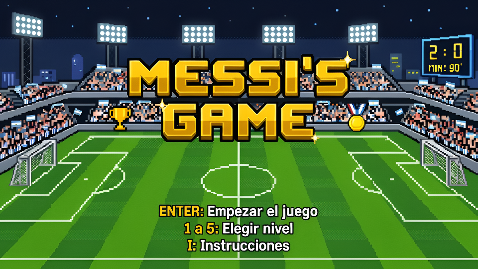

# Messi Game

Juego de tipo arcade en pixel art hecho con **Wollok Game** que recorre la carrera de Messi en la Selección a lo largo de **5 niveles**. Controlás a Messi y atrapás objetos que caen: los buenos suben su **barra emocional** y los malos la bajan. Con la barra vacía perdés el nivel; llenarla (o cumplir el objetivo del último nivel) te hace avanzar.

🎮 **Jugar online:** [Jugar ahora](https://rhornamasias.github.io/messi-game/)

## Participantes

- Rodrigo Horna
- Ivan Ignacio Schneider
- Ramiro Segovia
- Jeremias Boutet 

**Institución:** Universidad Tecnológica Nacional, Facultad Regional Buenos Aires (UTN FRBA). Materia: Paradigmas de Programación.

## Cómo se juega

Messi se mueve de izquierda a derecha en la parte baja de la pantalla, mientras desde arriba caen objetos.

| Tipo | Ejemplos | Efecto |
|------|----------|--------|
| Buenos | Gol, Copa América, Camiseta 10, Copa del Mundo, entre otros | Suben la barra |
| Malos | Tarjeta roja, Crítica, Final perdida, Sancor Seguros,entre otros | Bajan la barra |

- Cada nivel arranca con la barra al 50%. Si llega a **0%**, perdés y podés reintentar el nivel.
- Si **dejás caer** un objeto bueno sin atraparlo, la barra baja un 1%.
- El valor de la barra define el estado emocional de Messi:
  - **Gloria** (barra alta): Messi se mueve más rápido y los objetos caen más lento.
  - **Estable** (barra media).
  - **Crisis** (barra baja): Messi se mueve más lento, los objetos caen más rápido y predominan los malos.
- A medida que avanzás de nivel, el juego se vuelve más difícil.

### Niveles

| Nivel | Época | Objetivo |
|-------|-------|----------|
| 1 | Debut y primeros años | Llenar la barra |
| 2 | Mundial Sudáfrica 2010 | Llenar la barra |
| 3 | Mundial Brasil 2014 | Llenar la barra |
| 4 | Años de crisis y dolor | Llenar la barra |
| 5 | Coronación de gloria | Juntar las 3 copas del mundo (1978, 1986 y 2022). Las copas solo aparecen en estado de gloria |

### Controles

| Tecla | Acción |
|-------|--------|
| ← / → | Mover a Messi |
| Enter | Empezar desde el nivel 1, empezar un nivel, pasar al siguiente o reintentar |
| 1 a 5 | Elegir nivel (en el menú) |
| I | Ver las instrucciones (en el menú) |
| M | Volver al menú (en cualquier pantalla; también sale de las instrucciones) |

## Cómo ejecutarlo localmente

1. Instalá [Wollok](https://www.wollok.org/) (extensión de VS Code o Wollok IDE).
2. Clonás este repositorio: `git clone https://github.com/rhornamasias/messi-game.git`
3. Abrí la carpeta y ejecutá `code.wpgm`.
4. Para correr los tests: `tests/juego.wtest`.

## Diseño

El código aplica los conceptos del paradigma de objetos:

- **Polimorfismo:** 
  - *Niveles:* `nivel1` a `nivel5` responden a los mismos mensajes (`crisis`, `estable`, `gloria` y sus datos), y la partida los trata a todos igual.
- *Objetivos:* `ObjetivoLlenarBarra` y `ObjetivoJuntarCopas` responden a `seCumplio`, `recolectado` y `reiniciar`. La partida no pregunta en qué nivel está: le pregunta al objetivo si se cumplió.
  - *Recolectables:* cada tipo define su sonido, si es una copa del mundo y qué pasa cuando cae al piso (`alCaerAlPiso`: los buenos restan a la barra, los malos no hacen nada).  
- **Delegación:** la barra emocional avisa a la partida cuando se pierde y le pasa el estado a Messi; el nivel define cómo es cada estado (cooldown, velocidad de caída, objetos posibles); el objetivo decide cuándo se gana.
- **Encapsulamiento:** cada objeto protege su estado y expone solo mensajes del dominio. La barra emocional guarda su porcentaje internamente y solo se modifica con `modificarPorcentaje` (y `reiniciar`), que lo mantiene entre 0% y 100% y actualiza el estado de Messi. Messi controla su propia posición: solo se mueve con `moverseALaIzquierda` y `moverseALaDerecha`, que respetan los bordes del tablero y el cooldown. 

## Licencia

El código se distribuye bajo licencia MIT (ver [LICENSE](LICENSE)). Las imágenes, la música y los sonidos pueden tener derechos de terceros.